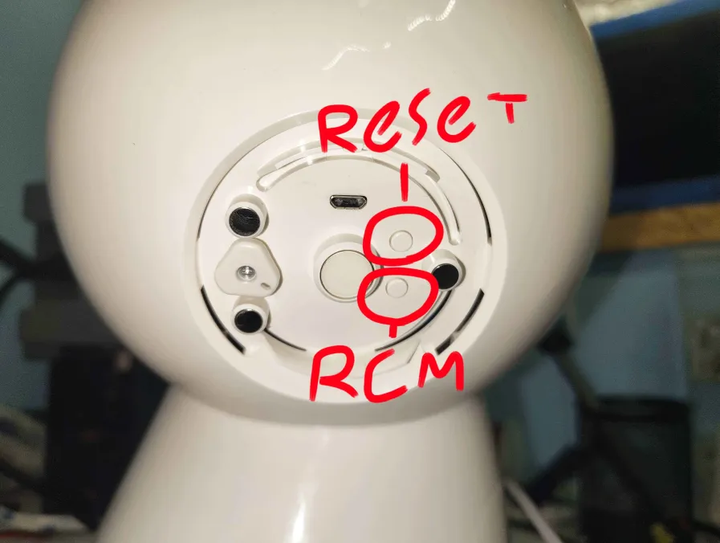
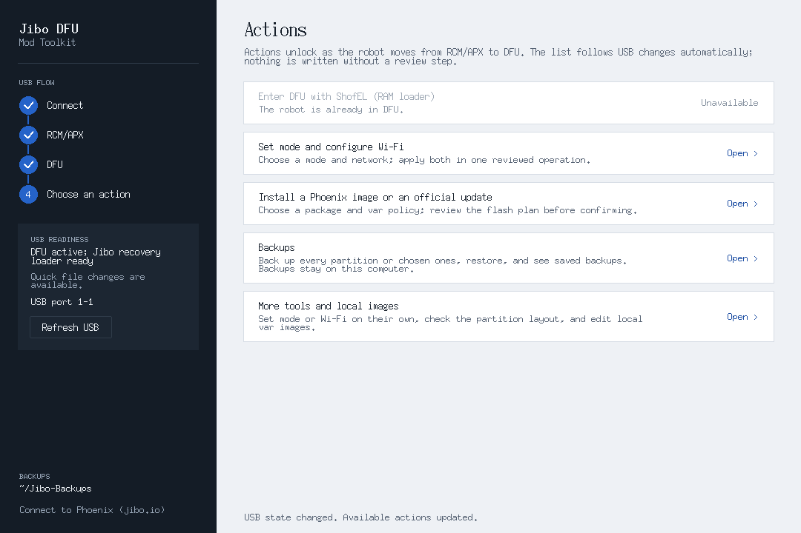
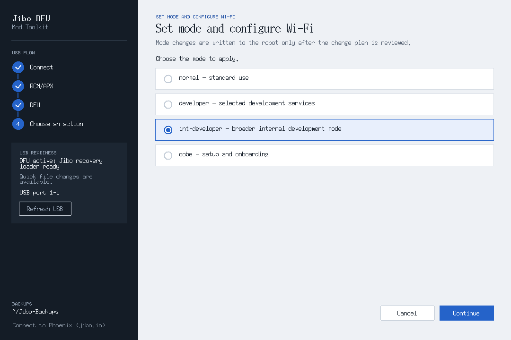

The Jibo DFU Mod Toolkit talks to Jibo over USB. It backs him up, changes his mode and Wi-Fi, and installs software images, from a window that walks you through each step. It replaces [JiboAutoMod](/mod/automod/): there's a single download for Windows, Mac and Linux, and nothing to compile.

:::tip[Info]{icon="information"}
Nothing gets written to Jibo until you've seen a review screen and confirmed it, and the toolkit saves a backup of his settings before it writes. If your Jibo is already modded (you can SSH into him), you can skip this page and go to [Choose a server](/start-here/choose-a-server/).
:::

## Requirements
- A Jibo, plugged into power
- A micro-USB **data** cable (it must be able to transfer data)
- One of these computers:
  - A Windows PC (x64)
  - A Mac, Apple silicon or Intel, running macOS 15 or newer. Apple silicon support is still experimental.
  - A Linux PC (x86_64) with a desktop, running Ubuntu 22.04 or newer, or a similar distro

Older Macs can run the toolkit from source; see its [README](https://github.com/Paskooter/Jibo-DFU-Mod-Toolkit#readme).

## Download the Toolkit
Get the file for your computer from the [latest release](https://github.com/Paskooter/Jibo-DFU-Mod-Toolkit/releases/latest):

| Computer | File | How to open it |
| --- | --- | --- |
| Windows | `Jibo-DFU-Windows-x64.exe` | Double-click it. If SmartScreen pops up, click **More info → Run anyway**. The first time, it sets up WSL 2 and usbipd-win and asks for administrator approval. |
| Mac (Apple silicon) | `Jibo-DFU-macOS-arm64.dmg` | Open it, drag **Jibo DFU Mod Toolkit** to Applications, then open the app. If macOS blocks it, go to **System Settings → Privacy & Security → Open Anyway**. |
| Mac (Intel) | `Jibo-DFU-macOS-x86_64.dmg` | Same as Apple silicon. |
| Linux | `Jibo-DFU-Linux-x86_64.AppImage` | Make it executable with `chmod +x Jibo-DFU-Linux-x86_64.AppImage`, open it, and approve the USB administrator prompt. |

The builds aren't signed, which is why Windows and macOS warn you the first time. If you want to check your download, compare it against the release's `SHA256SUMS` file.

## Put Jibo in RCM Mode
Every USB step starts with Jibo in RCM (**R**e**C**overy **M**ode). The buttons are on the round panel under the hatch on the back of his head.

1. Fully shut Jibo down.
2. Open the hatch on the back of his head.
3. Plug the USB cable into your computer and into Jibo's micro-USB port under the same hatch.
4. Press and hold the RCM button, the lower of the two small buttons. Keep holding it while you turn Jibo back on with his power button, then let go.
5. In RCM mode the red light on his forehead stays on and you don't hear his startup chime. If he chimes or starts up normally, shut him down and try again.

The toolkit should now say **RCM/APX detected**. If it doesn't, check the cable and click **Refresh USB**. The toolkit's **How do I put Jibo in RCM mode?** link shows these same steps.

## Enter DFU
Choose **Enter DFU with ShofEL (RAM loader)** and approve it. This starts a small recovery program in Jibo's memory and doesn't write anything to him. On Windows, approve the USB prompt if one appears.

Once **USB READINESS** says **DFU active; Jibo recovery loader ready**, the rest of the actions unlock:

## Back Him Up
The toolkit already keeps a backup of Jibo's var partition (his settings, Wi-Fi, name and calibration) before it changes anything. We still recommend a full backup before you go any further:

1. Open **Backups → Back up every partition**.
2. Look over the list of partitions and make sure your computer has enough free space, then start it.
3. Leave the cable and the window alone until it finishes. A full backup takes a while, so put something on while you wait.

Backups go in a `Jibo-Backups` folder, sorted by your robot's name and the date. **Backups → Saved backups** lists them and can open their folder, and **Restore partitions** puts one back. The toolkit won't restore another robot's backup onto this one. On Windows the toolkit usually keeps its files inside its own Linux, so copy your backups somewhere else on your PC too.

## Set int-developer Mode and Wi-Fi
:::note
You need this step for **5x1** and for Phoenix's **setup command**. If you're going to flash the **Phoenix image**, skip it, since the image doesn't need int-developer mode or SSH. Go straight to [Connect to Phoenix](/mod/phoenix/).
:::

Jibo usually runs in "normal" mode, which blocks most ports, including SSH (port 22). "int-developer" mode (short for internal developer) opens them up, so the server setup scripts can reach him.

1. Choose **Set mode and configure Wi-Fi**.
2. Select **int-developer** and continue.
3. Enter your Wi-Fi name and password. You'll type the password twice.
4. Leave **Show Wi-Fi status and IP on the boot screen** checked. It puts his IP address on his screen, and you'll need it next.
5. Review the change and confirm. Keep USB connected until the toolkit says the change is verified.

When it's done, the toolkit shows an optional card about connecting to Phoenix. If you're going with 5x1, just choose **Not now**.

If Jibo already has your Wi-Fi saved, **More tools and local images → Set robot mode → int-developer** changes only his mode. That skips the IP line on his boot screen, so you'll have to find his IP in your router's device list instead.

## Restart Jibo and Find His IP
Restart Jibo: fully shut him down, then turn him back on with his power button. Don't hold the RCM button this time. In int-developer mode he won't show his usual eye and menu. You'll see a green checkmark instead, and that's what you want.

His boot screen shows how his Wi-Fi is doing:

| On Jibo's screen | What it means |
| --- | --- |
| `Wi-Fi: checking...` | He's still starting up. Give it a moment. |
| `Wi-Fi: connected to <network> · IP <address>` | All good. Write down that IP address. |
| `Wi-Fi: connected, waiting for address` | He joined the network but doesn't have an address yet. Wait a minute, and if it stays like this, check your router. |
| `Wi-Fi: not connected` | Check the Wi-Fi name and password and that he's in range of your router, then run **Set mode and configure Wi-Fi** again. |
| `Wi-Fi: status unavailable` | Restart him once. If it's still there, ask for help (see below). |

You can remove the status line later with **More tools and local images → Remove boot-screen Wi-Fi/IP status**.

## Next Up
[Choose a server](/start-here/choose-a-server/), then follow [Connect to 5x1](/mod/pmscript/) or [Connect to Phoenix](/mod/phoenix/).

## If Something Goes Wrong
- If Windows setup stops, the setup window has **Copy details** and **Open log folder**. Paste those details when you ask for help.
- The toolkit's [README](https://github.com/Paskooter/Jibo-DFU-Mod-Toolkit#readme) has more troubleshooting.
- For problems with the toolkit itself, open a support ticket in **#help** on the [Phoenix Discord](https://discord.gg/FyDVYQ6FfV), where the toolkit's author answers. For anything else, ask in the [Jibo Revival Group Discord](https://discord.gg/CBVJzkRGwN).

Any stock Jibo that has never been modified is supported with 100% certainty: Paskooter has personally tested every stock firmware version and all stock files. If your robot was previously changed by another mod system, it will most likely work with no changes, but that can't be guaranteed, since there's no way to foresee changes someone else made.
