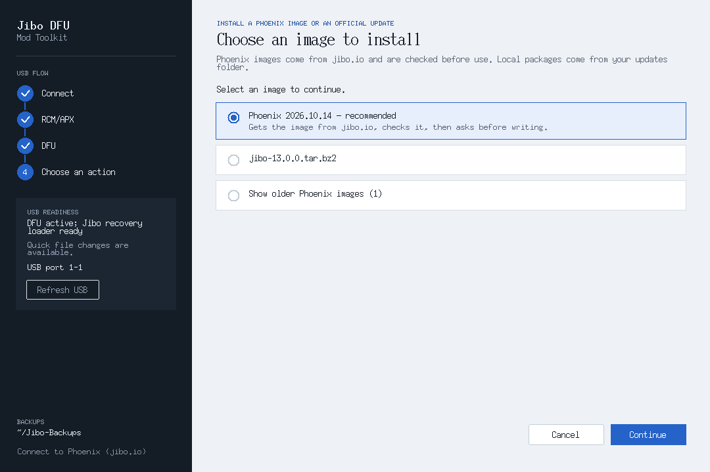
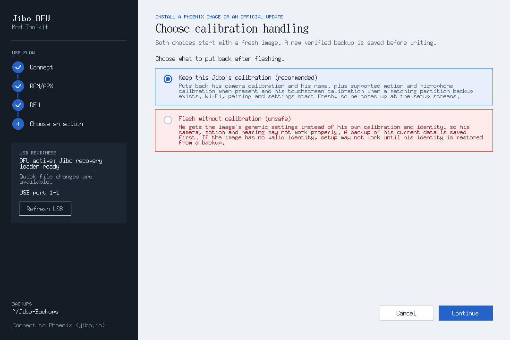

There are two ways to connect Jibo to [Phoenix](https://jibo.io):

- **Flash the Phoenix image** with the DFU toolkit. This is the main way. It puts fresh Jibo software on him that's already set up for Phoenix, so you don't need int-developer mode or SSH.
- **Run the setup command** from the jibo.io console. Use this one if you'd rather not reflash him.

Either way, you'll need a free account. Make one at [jibo.io/create](https://jibo.io/create) if you don't have one yet.

## Flash the Phoenix Image
1. Open the [DFU toolkit](/mod/dfu-toolkit/), put Jibo in [RCM mode](/mod/dfu-toolkit/#put-jibo-in-rcm-mode) with USB connected, and choose **Enter DFU with ShofEL (RAM loader)**.
2. Choose **Install a Phoenix image or an official update**. The Phoenix image is at the top of the list, marked **recommended**. Select it and continue.

   

3. Keep **Keep this Jibo's calibration (recommended)** selected. It puts back his camera calibration and his name after the flash. The other choice is marked unsafe, so don't use it unless you know you need it.

   

4. The toolkit downloads the image from jibo.io (about 800 MB), checks it and shows you what it's going to write. Confirm, and keep USB connected until it says it's done. If your internet drops during the download, it picks back up by itself.
5. Restart Jibo yourself rather than waiting for him to do it: fully shut him down, then turn him back on with his power button. Don't hold the RCM button this time.
6. He starts at his setup screen, which says **Go to jibo.io to get started**.

Flashing starts his Wi-Fi, pairing and settings fresh. The toolkit backs up his current settings before it writes anything.

## Set Him Up With a QR Code
1. Sign in at [jibo.io](https://jibo.io/app) and open **Robots → Add a Jibo**.
2. It asks whether he's already connected to jibo.io. His screen says **Go to jibo.io to get started**, so he is: choose **Yes**, then **New, unpaired Jibo: QR setup**.
3. Enter your Wi-Fi name and password and choose **Show setup code**.
4. Tap Jibo's screen, then hold the code up to his eye.
5. He shows **Connecting to** your network for about a minute, then a success animation, and the console tells you he's set up. If there's an update for him, his update screen comes up next, with a ring that fills up as he downloads.
6. Leave him plugged in while he downloads and installs his update. He restarts a few times on his own. When he's done, say "Hey Jibo"!

A couple of things that trip people up:
- Each setup code works once and lasts 15 minutes. If a scan doesn't work, or Jibo says the code expired, make a new code and try again.
- If the console shows the code in more than one frame, Jibo asks for them one at a time: tap his screen when he asks for the next one, and tap the code in the console to switch frames.
- If he sits on **Connecting to** for more than a few minutes, ask for help in #help on the [Phoenix Discord](https://discord.gg/FyDVYQ6FfV).

## Or: Use the Setup Command
This connects Jibo without reflashing him. He needs to be in int-developer mode and on your Wi-Fi first: follow [Set int-developer Mode and Wi-Fi](/mod/dfu-toolkit/#set-int-developer-mode-and-wi-fi) and write down the IP address on his boot screen.

1. Sign in at [jibo.io](https://jibo.io/app) and open **Robots → Add a Jibo**.
2. When it asks whether he's already connected to jibo.io, choose **No** (**I'm not sure** does the same thing), then **Check and prepare this Jibo**.
3. The console makes a one-line command just for your account. Pick your computer (**Windows** or **macOS / Linux**) and copy it. It looks like this, with your own code at the end:

   ```bash
   bash <(curl -fsSL https://jibo.io/setup) --claim-code <your code>
   ```

4. Run it on a computer on the same network as Jibo. On Windows, paste it into PowerShell or Command Prompt; it runs in WSL, which the DFU toolkit already uses. On a Mac or Linux PC, paste it into a terminal.
5. When it asks, type in Jibo's IP address. It shows you what it's going to change and waits for you to confirm.

What happens next depends on your Jibo:
- **He was set up before** (for example, with the original Jibo app): he's linked to your account, then downloads and installs the latest software from Phoenix. That takes a while, and he restarts several times.
- **He's new or was factory reset:** he restarts into his setup screen. Then follow [Set Him Up With a QR Code](#set-him-up-with-a-qr-code).

Either way he keeps his calibration and his name. The code in the command is private and only works once. If you open the page again, you get a new one.

## Need Help?
The [setup guide on jibo.io](https://jibo.io/guide) goes through the same steps. For help, open a support ticket in #help on the [Phoenix Discord](https://discord.gg/FyDVYQ6FfV).
